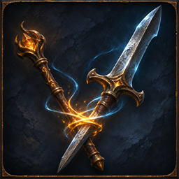

# Equipment Fusion

Author: **JJ ouyang**.

When enabled, equipment with a native skin transfer automatically gains the donor's numerical attributes and local
defences. Each item retains its own modifiers, quality, sockets and gems. Use the game's skin-transfer picker and
reclaim action; the GM tool only installs the mod, changes its switch and shows its actual load status.

Choose the single **Skin Transfer**, rather than a similarly named pack, in the native microtransaction stash.
The 3.29 client requires the donor's sockets to be empty before its picker accepts the donor; remove its gems first.
The mod does not bypass that client restriction. Saved donors containing gems still retain them on reclaim, and those
gems never supply stats, requirements or skills while the item is a donor.

## Scope

- Body armour, helmets, gloves, boots, belts, amulets and rings contribute. Both weapon hands and the stored weapon sets
  are excluded, including shields and quivers.
- Global numerical modifiers use the server's existing item-stat rules and requirement qualification. Local armour,
  evasion, energy shield and ward are calculated on each item before the completed values are combined.
- Donor socketed gems, granted skills and triggered skills never enter the player's skill-source collections. Numeric
  trigger controls are removed from the calculation view. Ordinary numerical modifiers in the same row are retained.
- Reclaim returns the original donor with all of its properties and gems. Disabling or uninstalling the mod removes
  its extra contribution on the next equipment/stat refresh. Native binding, storage and reclaim remain available.
- Existing skin transfers start contributing when the mod is enabled. No additional selection or mod chat command is needed.

## Required server update

Requires LocalExile's native skin-transfer implementation and the general `GameEvents.ItemStatSources` interface,
merged in [LocalExile #1155](https://github.com/LocalExile/LocalExile/pull/1155), and `Player` (0.6.0-beta). Works with
LocalExile 0.6.0-beta and 0.6.1-beta.

Build with `dotnet build mods/equipmentfusion/equipmentfusion.csproj -p:LocalExileRoot=<matching-checkout>`.
Install the output in `Mods/Binaries/equipmentfusion/` of that matching server. It starts disabled.

## Controls

No added commands or tunable settings. Use Waypoint or the GM tool, or the official `/mod`, `/mod_enable equipmentfusion`,
`/mod_disable equipmentfusion` and `/mod_reload equipmentfusion` commands. Native actions remain the way to bind and reclaim.

## Icon

Reuses the original 256 by 256 Equipment Fusion artwork, made from the author's game screenshots and gameplay description.

## Validation

See the accompanying change description for the tested server revision, automated checks and native-client acceptance.
