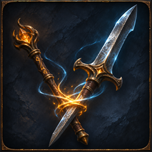

# Equipment Fusion

Author: **JJ ouyang**.

A skin-transfer donor remains a separately saved item and can be reclaimed. Its global modifiers, completed weapon damage, armour defences and local accuracy can contribute to the equipped target. The target keeps its weapon speed, critical chance, weapon type, range, sockets and skills. Donor granted and triggered skills do not contribute.

## Compatibility

This mod requires the Gateway API added by [LocalExile #790](https://github.com/LocalExile/LocalExile/pull/790).
The manifest lists 0.4.2-beta provisionally for review. To install this mod, use a server build with that PR applied.
Release compatibility will be set to the first LocalExile version that ships the required API.

## Installation and settings

Build the project with the matching LocalExile checkout as LocalExileRoot, then install its output in `Mods/Binaries/equipmentfusion/` of a server with the required API.
The manifest starts disabled. `/mod_enable equipmentfusion`, `/mod_reload equipmentfusion` and `/mod_disable equipmentfusion` control its lifecycle.
Declared settings are in `settings.json` when present; the user's overrides belong in `data/mods/equipmentfusion.json`.

The mod provides `/skin_transfer list`, `/skin_transfer info <id>`, `/skin_transfer bind <id>` with the donor on the cursor, and `/skin_transfer remove <id>` with an empty cursor. Native skin-transfer actions use the same saved donor. Disabling this mod removes the extra stats on the next equipment/stat rebuild; donors remain available for reclamation.

## Validation

The associated server tests cover the policy's default, enable, reload and disable behaviour and its game rules.
See the pull request for current build and in-game verification status.

## Icon

The 256×256 icon is AI-assisted original artwork based on LocalExile in-game screenshots and this mod's gameplay description.
