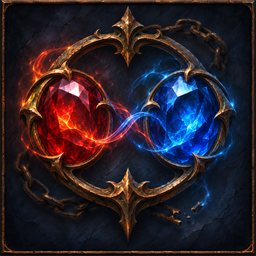

# Forbidden Freedom

Author: **JJ ouyang**.

Matching Forbidden Flame and Forbidden Flesh pairs grant their notable from active, qualified jewel sockets. Cross-class access and the maximum number of distinct grants are configurable. A value of zero removes the pair cap. Duplicate grants still count once and do not consume or alter paid passive or ascendancy allocations.

## Compatibility

This mod requires the Gateway API added by [LocalExile #791](https://github.com/LocalExile/LocalExile/pull/791).
The manifest lists 0.4.2-beta provisionally for review. To install this mod, use a server build with that PR applied.
Release compatibility will be set to the first LocalExile version that ships the required API.

## Installation and settings

Build the project with the matching LocalExile checkout as LocalExileRoot, then install its output in `Mods/Binaries/forbiddenfreedom/` of a server with the required API.
The manifest starts disabled. `/mod_enable forbiddenfreedom`, `/mod_reload forbiddenfreedom` and `/mod_disable forbiddenfreedom` control its lifecycle.
Declared settings are in `settings.json` when present; the user's overrides belong in `data/mods/forbiddenfreedom.json`.

The mod provides `/forbidden_jewel list` and `/forbidden_jewel flame|flesh <notable name or graph id>`. Removing a pair, closing its socket, disabling the mod or changing area removes its derived effect on the next stat rebuild. Saved jewel items remain intact.

## Validation

The associated server tests cover the policy's default, enable, reload and disable behaviour and its game rules.
See the pull request for current build and in-game verification status.

## Icon

The 256×256 icon is AI-assisted original artwork based on LocalExile in-game screenshots and this mod's gameplay description.
