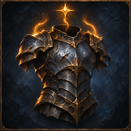

# Top Tier Drops

Author: **JJ ouyang**.

New magic and rare equipment from monsters and Delve reward containers rolls the highest eligible tier of each selected affix series. Item level, influence, original series weights and value ranges still apply. Flasks, jewels, unique items, crafting and existing items are unchanged.

## Compatibility

This mod requires the Gateway API added by [LocalExile #789](https://github.com/LocalExile/LocalExile/pull/789).
The manifest lists 0.4.2-beta provisionally for review. To install this mod, use a server build with that PR applied.
Release compatibility will be set to the first LocalExile version that ships the required API.

## Installation and settings

Waypoint can install this folder, or its contents can live in `Mods/Binaries/toptierdrops/` of a server with the required API.
The manifest starts disabled. `/mod_enable toptierdrops`, `/mod_reload toptierdrops` and `/mod_disable toptierdrops` control its lifecycle.
Declared settings are in `settings.json` when present; the user's overrides belong in `data/mods/toptierdrops.json`.

A highest eligible tier can be lower than the game's absolute top tier on a low-level base. This does not maximise the numeric roll within a tier.

## Validation

The associated server tests cover the policy's default, enable, reload and disable behaviour and its game rules.
See the pull request for current build and in-game verification status.

## Icon

The 256×256 icon is AI-assisted original artwork based on LocalExile in-game screenshots and this mod's gameplay description.
